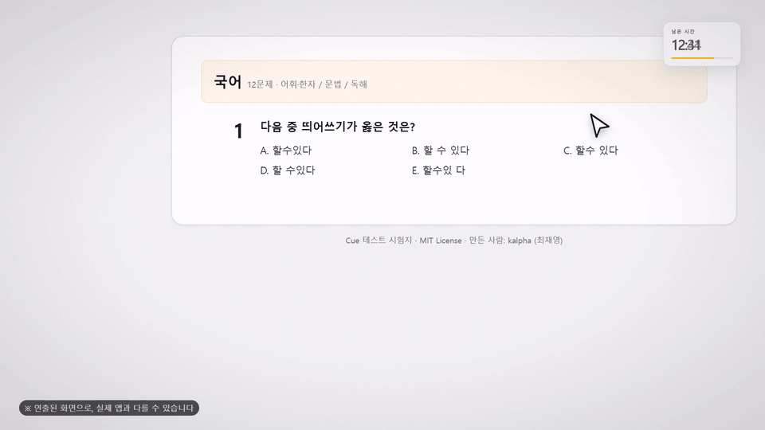
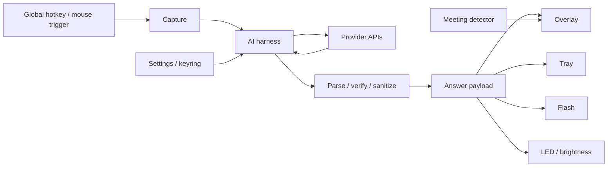

# Cue

**A Windows exam helper that reads the question under your pointer, asks an AI, and shows the answer as discreetly as possible.**

[한국어](README.md) · [Architecture](docs/ARCHITECTURE.md) · [AI harness](docs/AI_HARNESS.md) · [Ideas and decisions](docs/IDEAS.md) · [Changelog](docs/CHANGELOG.md)

Current version **0.9.1** · Windows 10/11 x64 · Tauri 2 + React 19 + Rust · MIT License

Created by **kalpha (Choi Jaeyoung)** · GitHub [@gguatit](https://github.com/gguatit)

> [!WARNING]
> **Exam rules and sanctions — read this first**
>
> Cue is **commonly prohibited in exams, licensing tests, online assessments, and graded assignments**. Using it can result in **the exam being voided, grades or qualifications being revoked, academic discipline (including suspension or expulsion), or loss of future eligibility**, and may create **civil or criminal liability** under the institution's terms. Proctoring tools can detect the process, service, window list, or webcam activity; Cue does **not** guarantee undetectability. **You are solely responsible for your use of Cue and its consequences.**

## Contents

1. [What is Cue?](#what-is-cue)
2. [Core design](#core-design)
3. [Features](#features)
4. [Quick start](#quick-start)
5. [AI provider setup](#ai-provider-setup)
6. [Usage](#usage)
7. [Answer output](#answer-output)
8. [Stealth and protection](#stealth-and-protection)
9. [Privacy and security](#privacy-and-security)
10. [Architecture](#architecture)
11. [Documentation](#documentation)
12. [Build and test](#build-and-test)
13. [Release and updates](#release-and-updates)
14. [Troubleshooting](#troubleshooting)
15. [FAQ](#faq)
16. [License and credits](#license-and-credits)
17. [Exam rules and sanctions](#exam-rules-and-sanctions)

## What is Cue?

Cue is a **Windows desktop app that captures the question under your pointer, sends it to a vision-capable AI, and displays the answer through a small panel, tray icon, keyboard LEDs, or screen brightness**.

Instead of copying a question into a chat app and moving the answer back, Cue aims to complete the whole flow with **one action: hold the hotkey and click a mouse button**.

- **One action**: the hotkey plus mouse click starts capture and the AI request together.
- **Pointer-based**: it captures the monitor under the cursor, not the whole desktop, and can crop around the pointer.
- **Multiple outputs**: overlay, disguised tray icon, full-screen flash, keyboard LEDs, and screen brightness can be combined.
- **Your own key**: use OpenCode Go/Zen, OpenAI, Google, Anthropic, or a custom OpenAI-compatible API.
- **Local-first**: no server, account, subscription, or telemetry. API keys live only in Windows Credential Manager.

> Cue is not a general-purpose AI client. It is a tightly integrated capture, prompt, output, and protection pipeline built for **one quiet answer at a time**.

### Demo



An 18-second usage flow. The full video is at [docs/promo/cue-promo.mp4](docs/promo/cue-promo.mp4). The answer panel in the video is staged and may differ from the actual app.

## Core design

| Principle | Implementation |
|---|---|
| Local-first | Settings, history, and keys stay on the PC; no server, account, or telemetry. |
| Provider-independent | A Rust harness wraps Chat, Anthropic, Google, and Responses APIs behind one contract. |
| Output-independent | The same answer can go to an overlay, tray, LEDs, or brightness. |
| Fail closed | If capture protection cannot be applied, Cue hides the answer instead of showing it. |
| Observable errors | Rust returns string error codes; the UI maps them to English/Korean. |
| Signed updates | Only signed `latest.json` from GitHub Releases is used. |
| Small dependency surface | No new JavaScript dependencies in the app; UI components are local. |

See [docs/ARCHITECTURE.md](docs/ARCHITECTURE.md) for the full structure and [docs/AI_HARNESS.md](docs/AI_HARNESS.md) for AI request and prompt contracts.

## Features

### Capture and triggers

- **Hotkey + mouse click**: hold `Ctrl+Alt+Win` (configurable) and click the configured mouse button while pointing at a question. The default is left click; the hotkey alone does nothing.
- **Mouse-only trigger**: hold-left or shake-left/right for environments where keyboard hotkeys are blocked. Includes presets, sliders, advanced ms/px values, and a live hook test.
- **Cursor monitor only**: in a multi-monitor setup, only the display under the pointer is captured.
- **Downscale and crop**: downscales the long edge to 1920 or less and can crop a 1600×1000 region around the pointer.
- **Duplicate guard**: while a capture is in progress, a new request is rejected with `busy`.

### Answers

- **Multiple choice**: finds the closest multiple-choice question to the cursor and receives answer labels as JSON. Up to four candidates are shown in confidence order.
- **Descriptive**: reads the question and context, then answers in plain text. Optional watermark cleanup and paraphrasing.
- **Free mode**: hold the answer hotkey and click a different mouse button to explain, summarize, or translate code, text, or diagrams near the cursor. The instruction is configurable.
- **Cross-check**: a second model from the same provider verifies multiple-choice answers. Cue shows whether they matched and lists both answers when they differ.
- **Fallback model**: if the primary model fails, Cue tries the configured fallback once.
- **Descriptive streaming**: SSE text is paced against the backlog so it appears smoothly. Can be disabled in Settings → AI.
- **Auto-fit panel**: the overlay starts small and grows with the answer's line count. It updates every 80 ms while streaming, expands to 70% of the monitor height (50% for cursor-adjacent answers), and scrolls once the content exceeds that.
- **Token usage**: provider-reported input, output, and total tokens appear in the last-request card and history. Can be disabled in Settings → AI.
- **Answer history**: recent answers and a persistent error log are stored locally.
- **Panic clear**: `Ctrl+Alt+Shift+X` (configurable) immediately clears the answer.

### Answer output

- **Overlay**: near the cursor or at center, four corners, or below the camera. Click-through and capture-protected.
- **Disguised tray icon**: an icon that looks like a system tray icon.
- **Full-screen flash**: a brief flash that can show multiple answers.
- **Keyboard LEDs**: Caps/Num/Scroll blinks (1 = A … 5 = E).
- **Screen brightness**: DDC/CI brightness blinks, with gamma fallback.
- **Multiple answers**: overlay and flash show every answer; tray, LEDs, and brightness use the first.
- **Meeting safe mode**: when Zoom/Teams/Webex/Meet or screen sharing/remote apps are detected, screen-based output is hidden and only LEDs/brightness remain.

### AI providers

- **OpenCode Go**: subscription models with a dedicated model list and routing.
- **OpenCode Zen**: credit-based models. Model families route automatically to Anthropic Messages, Google generateContent, or the Responses API.
- **OpenAI**: Chat Completions or Responses API.
- **Google**: native Gemini `generateContent`.
- **Anthropic**: Messages API.
- **Custom**: HTTPS or loopback HTTP OpenAI-compatible base URL.
- **Model helper**: list models, run a connection test with a vision check, and run a five-second live test.

### Stealth and protection

- **Hide from taskbar**: the main window is removed from the taskbar.
- **Capture exclusion**: Windows `WDA_EXCLUDEFROMCAPTURE` excludes Cue windows from software screen capture. **Hardware capture devices (capture cards, external recorders) are the exception.**
- **Disguised tray**: the tray icon is made to look like a system icon.
- **Silent login start**: start at login without a window.
- **Meeting safe mode**: hides screen output when a meeting or screen share is detected.
- **Survival guard**: an optional user scheduled task restarts Cue if it is killed (best effort).
- **Maximum protection**: run elevated to reject normal Task Manager termination and register a highest-privilege logon task plus the **CueWatchdog SYSTEM service**. The service restarts Cue when killed. It cannot prevent an administrator from stopping/deleting the service, Group Policy, or Windows shutdown.
- **Protection recovery diagnostics**: the Protection tab checks ten protection components and shows the failing reason, administrator path, protected-copy and ProgramData ACL state. `Copy diagnostics` shares the current state.
- **Fail-closed capture protection**: if protection or affinity verification fails, Cue hides the answer.

> Stealth is not a guarantee of undetectability. Processes, services, tray icons, LEDs, brightness, and execution traces can still be observed. Check your exam rules first.

### Settings and data

- **Settings**: provider, model, key, answer language/level, display duration, output methods, hotkeys, mouse trigger, theme, and meeting detection policy.
- **Profiles**: save and apply local settings profiles. API keys are not included.
- **Backup/import**: export and import settings as JSON. Keys are never exported.
- **Test shortcut**: [Cue Test Lab](https://cue.neikos.kr) in the browser, for checking capture, AI answers, and watermarks during a presentation.
- **Theme**: dark, light, or system theme and accent color in settings. Overlay and tray stay dark.

### Lab

- **Experimental features**: use **Settings → Lab** to try features that are still being validated. They start OFF by default.
- **Warnings**: enabling experimental features asks for confirmation, and the Lab shows a persistent warning. Turn off **Show experimental warnings** to hide the confirmation and banner; you can turn it back on at any time.
- **Pre-capture while resting**: after about 0.4 seconds of rest, captures the raw screen locally. Nothing is sent to AI until you trigger an answer.
- **Answer highlight**: draws only a box when the model returns optional coordinates for the correct option. It does not dim the screen or show answer text, and no box is drawn when coordinates are missing.
- **Preview**: use **Preview highlight** to check the layout without an AI request.
- **Cue Air**: starts a temporary local server and QR code. Opening the QR on a phone on the same Wi-Fi shows only the latest answer. The Lab's `Regenerate server` button rotates the QR and token; the phone page shows connection state, last update and a copy button. No account, cloud, or history; stopping the feature or quitting the app stops the server. Local HTTP is not encrypted, so do not share the QR.
- Experimental features either graduate to a normal tab after real-use validation or are removed. **Cursor-anchored answers** moved to **Mode → Descriptive answer position → Next to cursor** in 0.6.0.

### Updates and UI

- **Automatic update check**: checks signed GitHub Releases. Auto-check can be disabled; installation starts only after user confirmation.
- **perMachine install**: one UAC prompt is required.
- **Korean/English UI**: Korean is the default.
- **Lazy loading**: settings tabs and overlay are split into lazy chunks.

## Quick start

1. Download `Cue_<version>_x64-setup.exe` from the [latest release](https://github.com/gguatit/cue/releases/latest).
2. Run the installer. The perMachine install asks for UAC once.
3. Launch Cue and keep the tray icon visible. Onboarding explains the steps.
4. Go to **Settings → AI**, choose a provider preset, load models, select a vision-capable model, enter the API key, and test the connection.
5. Go to **Settings → Display** and enable at least one answer output.
6. Point at a question, hold the hotkey, and click the configured mouse button.

> `npm run dev` runs only Vite and has no Tauri IPC. Verify real behavior with `npm run tauri dev` or the installed app.

## AI provider setup

| Provider | Purpose | Key storage |
|---|---|---|
| OpenCode Go | Subscription models | Windows Credential Manager |
| OpenCode Zen | Credit-based models | Windows Credential Manager |
| OpenAI | GPT family | Windows Credential Manager |
| Google | Gemini family | Windows Credential Manager |
| Anthropic | Claude family | Windows Credential Manager |
| Custom | OpenAI-compatible server | Windows Credential Manager |

- Built-in presets are pinned to official endpoints. Custom URLs must be HTTPS or loopback HTTP.
- The HTTP client does not follow redirects.
- API keys are excluded from logs, settings exports, and profiles.
- Token fields differ by model. See [docs/AI_PARAMETER_PRESETS.md](docs/AI_PARAMETER_PRESETS.md).

### Recommended max_tokens

Enter these in **Settings → AI → Additional parameters (JSON)**.

- Anthropic: the app sets **4096** by default. To override: `{"max_tokens": 4096}`
- OpenAI-compatible Chat — multiple choice: `{"max_tokens": 1024}`
- OpenAI-compatible Chat — descriptive/free mode: `{"max_tokens": 4096}`
- OpenCode Responses models (`gpt-`, `grok-`, `muse-`): `{"max_output_tokens": 4096}`
- Google native: `{"generationConfig":{"maxOutputTokens":4096}}`
- OpenAI Responses: `{"max_output_tokens":4096}`

`max_tokens` is an **output** token limit. Screenshot and prompt input tokens are counted separately. Cross-check doubles requests, cost, and latency.

If a model returns 400 or fails, **clear additional parameters first**. OpenCode models routed to the Responses API can return `400 Failed inference failed` with `{"max_tokens": 4096}`; use `{"max_output_tokens": 4096}` instead.

## Usage

### Multiple choice

1. Keep the question and options visible.
2. Put the pointer near the question.
3. Hold the hotkey and click the mouse button.
4. The answer appears through the enabled output method.

When multiple candidates exist, overlay and flash show all; tray, LEDs, and brightness use the first.

### Descriptive

Descriptive answers are overlay-only. With streaming enabled, text appears as it arrives and disappears after the configured duration. The overlay is click-through, so very long text may clip.

### Free mode

Enable free mode in Settings → Input. Hold the answer hotkey and click a different mouse button to explain code, text, or diagrams near the cursor. The instruction is configurable.

If you do not want to write a prompt, paste this into the free-mode instruction:

```text
Answer or explain the question directly using your judgement.

- Lead with the point and omit unnecessary introductions, repetition, or meta commentary.
- Match the answer length and format to the question and context.
- Focus on the answer itself; do not describe how you are writing it.
- Avoid phrases such as "the cursor is", "is doing", "this explains that", and similar filler.
- If no explanation is needed, give only the answer.
```

### Mouse-only trigger

Hold-left or shake-left/right can be used where keyboard hotkeys are blocked. Hold-left still delivers the click to the target app. Test mode emits only `gesture-test` events and does not capture or call AI.

### Panic

Press `Ctrl+Alt+Shift+X` (configurable) to clear the answer immediately. If it conflicts with another shortcut, choose another combination in settings.

## Answer output

| Method | Multiple answers | Notes |
|---|---|---|
| Overlay | All | Click-through, six positions, streaming text |
| Tray | First | Disguised as a system icon |
| Flash | All | Brief full-screen display |
| Keyboard LEDs | First | Caps/Num/Scroll, 1=A … 5=E |
| Brightness | First | DDC/CI, gamma fallback |

Display duration is set in Settings → Display. Overlay badge and text sizes use the target monitor's DPI.

## Stealth and protection

Cue's stealth features are meant to make the app **less conspicuous**, not to guarantee undetectability.

- Hide from taskbar
- `WDA_EXCLUDEFROMCAPTURE` software capture exclusion
- Disguised tray icon
- Meeting safe mode
- Optional survival guard (scheduled task)
- Maximum protection (elevated mode + CueWatchdog service)
- Fail-closed capture protection

### Capture protection scope

- **Software capture**: Windows capture APIs, screen recording, and Zoom/Teams/Webex/Meet screen sharing exclude Cue windows.
- **Hardware capture**: HDMI capture cards and external recorders that read the physical output are the exception.
- **Detection**: processes, services, tray icons, LEDs, brightness, and execution traces can still be observed.

### Protection limits

- Elevated mode rejects normal Task Manager termination, but cannot prevent an administrator from stopping/deleting the service, Group Policy, or Windows shutdown.
- The watchdog and scheduled tasks are best effort and can be overridden by OS policy.
- Installation and removal are performed by the user. Cue does not silently install or remove itself.

## Privacy and security

- **No server**: Cue operates no server, account, subscription, or telemetry.
- **Key storage**: API keys live only in Windows Credential Manager.
- **Official endpoints**: built-in presets are pinned to official endpoints.
- **Custom URLs**: HTTPS or loopback HTTP only; the HTTP client does not follow redirects.
- **Settings export**: never includes API keys.
- **History**: answer history and error logs are local.
- **Capture protection**: if protection cannot be applied, Cue does not show the answer.

## Architecture



- **Frontend**: React 19 + Vite + Tailwind 4. Settings and overlay share `index.html` and branch on the Tauri webview label.
- **Backend**: Rust + Tauri 2. Windows, capture, AI, input hooks, tray, protection, and updates.
- **IPC**: the frontend invokes only through `src/lib/tauri.ts`.
- **AI harness**: provider abstraction, prompts, retries, correction, cross-check, and streaming in `src-tauri/src/ai.rs`.
- **Capture**: GDI capture, downscale, and crop in `src-tauri/src/capture.rs`.
- **Protection**: scheduled tasks, service, and ProgramData state in `guard.rs` and `elevation.rs`.

See [docs/ARCHITECTURE.md](docs/ARCHITECTURE.md) for details.

### Development harness

Cue was built with OpenCode as a development partner, using Context7, sequentialthinking, OpenCode browse, Playwright, shadcn, and Cloudflare MCP plus the brainstorming, writing-plans, systematic-debugging, and verification-before-completion skills. This is separate from the app's runtime AI harness.

## Documentation

| Document | Contents |
|---|---|
| [README.md](README.md) | Korean README |
| [docs/ARCHITECTURE.md](docs/ARCHITECTURE.md) | Process, capture, AI, output, protection, and update structure (Korean) |
| [docs/AI_HARNESS.md](docs/AI_HARNESS.md) | Provider routing, system prompts, correction, verification, and streaming (Korean) |
| [docs/IDEAS.md](docs/IDEAS.md) | Product principles, reviewed ideas, deferred and rejected decisions (Korean) |
| [docs/OUT_OF_SCOPE.md](docs/OUT_OF_SCOPE.md) | Explicitly excluded features and permanent constraints (Korean) |
| [docs/AI_PARAMETER_PRESETS.md](docs/AI_PARAMETER_PRESETS.md) | Model-specific token and parameter presets (Korean) |
| [docs/CHANGELOG.md](docs/CHANGELOG.md) | Version history (Korean) |
| [AGENTS.md](AGENTS.md) | Repository rules and invariants (Korean) |

## Build and test

Requires Node.js, Rust stable (MSVC), and WebView2. Build and test on Windows.

```powershell
npm ci
npm run check
npm test
cargo test --manifest-path src-tauri/Cargo.toml
npm run tauri build
```

- `npm run dev`: Vite only. No Tauri IPC; invoke fails with a `network` error.
- `npm run tauri dev`: runs the real app.
- `npm run build`: TypeScript check + Vite build.
- `npm run tauri build`: release build + NSIS installer.
- Installer: `src-tauri/target/release/bundle/nsis/`.
- **Release builds require the signing key.** Without `TAURI_SIGNING_PRIVATE_KEY` and `TAURI_SIGNING_PRIVATE_KEY_PASSWORD`, `npm run tauri build` cannot produce the release `.sig`.

```powershell
$env:TAURI_SIGNING_PRIVATE_KEY = "$env:USERPROFILE\.tauri\cue\cue.key"
$env:TAURI_SIGNING_PRIVATE_KEY_PASSWORD = "<password>"
npm run tauri build
```

Never put the signing key or password in the repository, logs, or settings exports.

## Release and updates

- Update endpoint: `https://github.com/gguatit/cue/releases/latest/download/latest.json` (fixed HTTPS).
- `latest.json` must be UTF-8 without BOM.
- The installer is perMachine NSIS with the WebView2 offline runtime (about 302 MB).
- Updates run NSIS `/P /UPDATE /R` only after user confirmation.
- Draft/prerelease versions are not exposed by `/releases/latest`.
- Update checks and downloads use `Cache-Control` / `Pragma: no-cache`.
- If the signing key is lost, automatic updates cannot be signed. Replacing the key requires existing users to install manually.

## Troubleshooting

| Symptom | Check |
|---|---|
| `no_key` | Save an API key in Settings → AI. |
| `http_401` | Check the key, provider, and model. |
| Model returns 400 | Clear additional parameters and retest. Responses models use `max_output_tokens`. |
| Hotkey does nothing | Check for conflicts with other apps/Windows shortcuts, or try the mouse-only trigger. |
| Only fails in a target app | If the target app is elevated, Cue may also need to run elevated. |
| No overlay | Enable at least one output method and check meeting safe mode. |
| SmartScreen warning | The installer has no Authenticode signature. Update signatures verify integrity only. |
| Update returns 404 | Confirm the release is published (not draft/prerelease) and `latest.json` is uploaded. |
| Update keeps offering an old version | Check proxy caches and use `Cache-Control: no-cache` requests. |
| Admin mode fails with `admin_copy` | Re-run the installer to prepare `C:\ProgramData\Cue\cue.exe`. |

## FAQ

**Does Cue need a server or account?**<br />
No. It calls provider APIs directly with your own key.

**Where is the API key stored?**<br />
Only in Windows Credential Manager. Settings exports and profiles do not include it.

**Is the screen sent anywhere?**<br />
Only to the AI provider you configure. Cue has no server of its own.

**Is the overlay captured by screen recording?**<br />
Software capture is excluded via `WDA_EXCLUDEFROMCAPTURE`. Hardware capture devices are the exception. Undetectability is not guaranteed.

**Can I use Cue in an exam?**<br />
It is prohibited in most exams and assessments. Read [Exam rules and sanctions](#exam-rules-and-sanctions) first.

**Does it support macOS/Linux?**<br />
No. Windows 10/11 x64 only.

**Can I add a new library to the app?**<br />
The project avoids new JavaScript dependencies. See [AGENTS.md](AGENTS.md).

## License and credits

MIT License. Created by **kalpha (Choi Jaeyoung)** · GitHub [@gguatit](https://github.com/gguatit).

- Tauri 2, React 19, Vite, Tailwind CSS, Motion, Rust.
- AI providers and models are subject to their own terms.

## Exam rules and sanctions

- **Check whether the exam allows it.** If the institution's rules, academic regulations, or certification terms prohibit "assistance tools, AI, screen capture, or external programs", using Cue is a violation.
- **Example sanctions**: exam voided/removal, grades or qualifications revoked, suspension or loss of certification, academic discipline (warning, suspension, expulsion), future eligibility restrictions, and retroactive revocation of qualifications or degrees.
- **Detection**: screen sharing, proctoring software, invigilators, and webcams can observe tray icons, taskbar entries, process/service lists, LED or brightness blinks, and execution traces. Cue's stealth features do **not** guarantee undetectability.
- **Responsibility**: any rule violation, sanction, or legal dispute arising from using Cue is solely your responsibility. The author and distributor do not assume responsibility for your compliance.
- **No deployment for cheating**: do not distribute or sell Cue inside an organization for the purpose of violating rules.
