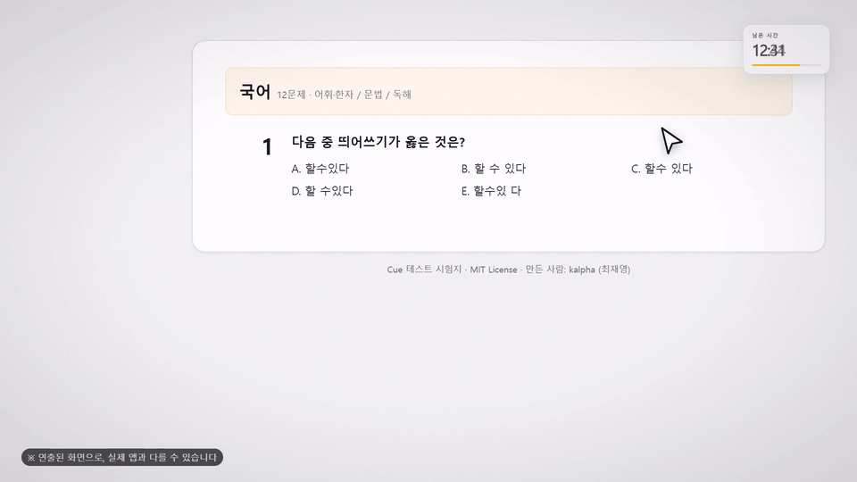
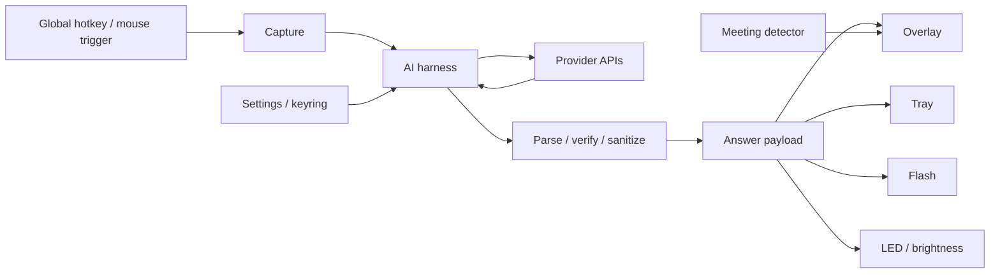

# Cue

**포인터 아래의 문제를 읽어 AI에 묻고, 정답을 최대한 티 나지 않게 보여 주는 Windows 시험 도우미.**

[English](README.en.md) · [아키텍처](docs/ARCHITECTURE.md) · [AI 하네스](docs/AI_HARNESS.md) · [아이디어와 결정](docs/IDEAS.md) · [변경 기록](docs/CHANGELOG.md)

현재 버전 **0.5.8** · Windows 10/11 x64 · Tauri 2 + React 19 + Rust · MIT License

만든 사람: **kalpha (최재영)** · GitHub [@gguatit](https://github.com/gguatit)

> [!WARNING]
> **시험 규정 위반과 제재 — 반드시 읽으세요**
>
> Cue는 **시험·자격 시험·온라인 평가·과제에서 사용이 금지되는 것이 일반적**입니다. 사용하면 **시험 무효, 성적 취소, 자격 박탈, 정학·퇴학·징계, 응시 자격 제한** 같은 규정상 제재를 받을 수 있고, 기관·주최 측 약관에 따라 **민사·형사 책임**이 발생할 수 있습니다. 감시 프로그램이 프로세스·서비스·창 목록·웹캠을 통해 사용을 확인할 수 있으며, Cue는 "탐지 불가"를 보장하지 않습니다. **사용과 그 결과에 대한 책임은 전적으로 사용자에게 있습니다.**

## 목차

1. [Cue란?](#cue란)
2. [핵심 설계](#핵심-설계)
3. [기능](#기능)
4. [빠른 시작](#빠른-시작)
5. [AI 공급자 설정](#ai-공급자-설정)
6. [사용법](#사용법)
7. [답 표시 방식](#답-표시-방식)
8. [스텔스와 보호](#스텔스와-보호)
9. [개인정보와 보안](#개인정보와-보안)
10. [아키텍처](#아키텍처)
11. [문서](#문서)
12. [빌드와 테스트](#빌드와-테스트)
13. [릴리스와 업데이트](#릴리스와-업데이트)
14. [문제 해결](#문제-해결)
15. [FAQ](#faq)
16. [라이선스와 크레딧](#라이선스와-크레딧)
17. [시험 규정 및 제재](#시험-규정-및-제재)

## Cue란?

Cue는 Windows에서 **포인터가 가리키는 문제를 캡처해 비전 지원 AI에 보내고, 답을 작은 패널·트레이·키보드 LED·화면 밝기 등으로 보여 주는 데스크톱 앱**입니다.

일반적인 채팅 앱처럼 질문을 복사하고 답을 다시 옮기는 대신, **단축키를 누른 채 마우스 버튼을 클릭하는 한 번의 동작**으로 캡처부터 답 표시까지 끝내는 것을 목표로 합니다.

- **한 번의 동작**: 단축키 + 마우스 클릭으로 캡처와 요청을 동시에 시작합니다.
- **포인터 기준**: 화면 전체가 아니라 커서가 있는 모니터를 캡처하고, 필요하면 포인터 주변만 잘라 냅니다.
- **다양한 출력**: 오버레이, 위장 트레이 아이콘, 전체 화면 플래시, 키보드 LED, 화면 밝기 중 원하는 방식을 조합합니다.
- **내 키 사용**: OpenCode Go/Zen, OpenAI, Google, Anthropic 또는 사용자 지정 OpenAI 호환 API를 사용합니다.
- **로컬 우선**: 서버·계정·구독·텔레메트리가 없고, API 키는 Windows 자격증명 관리자에만 저장합니다.

> Cue는 범용 AI 클라이언트가 아닙니다. **한 번의 조용한 답**이라는 한 가지 목적에 맞춰 캡처·프롬프트·출력·보호 기능을 촘촘하게 연결한 도구입니다.

### 시연



18초짜리 사용 흐름입니다. 전체 영상은 [docs/promo/cue-promo.mp4](docs/promo/cue-promo.mp4)에서 볼 수 있습니다. ※ 영상 속 답 패널은 연출된 화면으로, 실제 앱과 다를 수 있습니다.

## 핵심 설계

| 원칙 | 구현 |
|---|---|
| 로컬 우선 | 설정·기록·키가 PC에 남고, 서버·계정·텔레메트리가 없습니다. |
| 공급자 독립 | Rust 하네스가 Chat·Anthropic·Google·Responses API를 공통 계약으로 감쌉니다. |
| 출력 독립 | 같은 답을 오버레이·트레이·LED·밝기 어디로든 보낼 수 있습니다. |
| 실패 시 안전 | 캡처 보호가 실패하면 답을 표시하지 않고 숨깁니다. |
| 관찰 가능한 오류 | Rust는 문자열 오류 코드를 반환하고 UI가 en/ko로 번역합니다. |
| 서명된 업데이트 | GitHub Releases의 서명된 `latest.json`만 사용합니다. |
| 작은 의존성 | 앱에는 새 JavaScript 의존성을 추가하지 않고, UI는 자체 컴포넌트로 유지합니다. |

자세한 구조는 [docs/ARCHITECTURE.md](docs/ARCHITECTURE.md), AI 요청·프롬프트 계약은 [docs/AI_HARNESS.md](docs/AI_HARNESS.md)에 정리되어 있습니다.

## 기능

### 캡처와 트리거

- **단축키 + 마우스 클릭**: `Ctrl+Alt+Win`(변경 가능)을 누른 채 선택한 마우스 버튼을 클릭하면 커서가 있는 디스플레이를 캡처합니다. 기본값은 좌클릭이며, 키만 누르면 발동하지 않습니다.
- **마우스 전용 트리거**: 키보드 단축키가 막힌 환경을 위해 왼쪽 버튼 길게 누르기 또는 좌우 흔들기를 지원합니다. 프리셋·슬라이더·고급 ms/px 값과 실제 훅 테스트가 있습니다.
- **포인터 모니터만 캡처**: 다중 모니터에서 커서가 있는 화면만 대상으로 합니다.
- **자동 축소와 크롭**: 장변 1920 이하로 축소하고, 필요하면 포인터 주변 1600×1000을 잘라 요청 크기를 줄입니다.
- **중복 실행 방지**: 캡처가 진행 중이면 새 요청을 `busy`로 거부합니다.

### 답변

- **객관식**: 커서와 가장 가까운 객관식 문제를 찾아 정답 라벨을 JSON으로 받습니다. 최대 4개의 후보를 확신 순으로 표시합니다.
- **서술형**: 문제와 맥락을 읽고 플레인 텍스트로 답합니다. 워터마크 문자 정리와 선택적 패러프레이즈를 거칩니다.
- **자유 모드**: 답변 단축키를 누른 채 다른 마우스 버튼을 클릭하면 커서 주변의 코드·텍스트·도표를 설명·요약·번역합니다. 지시문을 직접 바꿀 수 있습니다.
- **교차 검증**: 같은 공급자의 두 번째 모델로 객관식 답을 검증합니다. 일치 여부와 후보 목록을 함께 표시하고, 불일치하면 두 답을 보여 줍니다.
- **대체 모델**: 주 모델이 실패하면 설정한 대체 모델로 한 번 더 시도합니다.
- **서술형 스트리밍**: SSE로 받은 글자를 백로그에 맞춰 자연스럽게 이어서 표시합니다. 설정 → AI에서 끌 수 있습니다.
- **토큰 사용량**: 공급자가 보고한 입력·출력·합계 토큰을 마지막 요청과 기록에 표시합니다. 설정 → AI에서 끌 수 있습니다.
- **답변 히스토리**: 최근 답변과 오류 로그를 로컬에 저장합니다.
- **패닉 클리어**: `Ctrl+Alt+Shift+X`(변경 가능)로 화면의 답을 즉시 지웁니다.

### 답 표시

- **오버레이**: 커서 옆 또는 화면 중앙·네 모서리·카메라 아래에 표시합니다. 클릭 통과이며 캡처 보호가 적용됩니다.
- **위장 트레이 아이콘**: 시스템 아이콘처럼 보이는 트레이 아이콘으로 답을 표시합니다.
- **전체 화면 플래시**: 짧은 플래시로 여러 정답을 보여 줍니다.
- **키보드 LED**: Caps/Num/Scroll LED 깜빡임으로 답을 표시합니다(1회 = A … 5회 = E).
- **화면 밝기**: DDC/CI 밝기 깜빡임을 사용하고, 실패하면 감마 폴백을 사용합니다.
- **다중 정답**: 오버레이와 플래시는 모든 정답을, 트레이·LED·밝기는 첫 번째 정답을 사용합니다.
- **회의 안전 모드**: Zoom/Teams/Webex/Meet 계열과 화면 공유·원격 앱이 감지되면 화면 기반 표시를 숨기고 LED·밝기만 사용합니다.

### AI 공급자

- **OpenCode Go**: 구독형 모델 목록과 전용 라우팅을 사용합니다.
- **OpenCode Zen**: 크레딧 기반 모델을 사용합니다. 모델 계열에 따라 Anthropic Messages·Google generateContent·Responses API로 자동 라우팅됩니다.
- **OpenAI**: Chat Completions 또는 Responses API를 사용합니다.
- **Google**: Gemini 네이티브 `generateContent` API를 사용합니다.
- **Anthropic**: Messages API를 사용합니다.
- **Custom**: HTTPS 또는 루프백 HTTP의 OpenAI 호환 base URL을 사용합니다.
- **모델 도우미**: 모델 목록 불러오기, 비전 검사를 포함한 연결 테스트, 5초 카운트다운 실전 테스트를 제공합니다.

### 스텔스와 보호

- **작업표시줄 숨김**: 메인 창을 작업표시줄에서 숨깁니다.
- **화면 캡처 제외**: Windows `WDA_EXCLUDEFROMCAPTURE`로 Cue 창을 소프트웨어 화면 캡처에서 제외합니다. **하드웨어 캡처 장치(캡처 카드·외부 녹화기)는 예외입니다.**
- **위장 트레이**: 트레이 아이콘을 시스템 아이콘처럼 위장합니다.
- **로그인 시 무음 시작**: 로그인할 때 창 없이 시작할 수 있습니다.
- **회의 안전 모드**: 회의·화면 공유 감지 시 화면 표시를 숨깁니다.
- **생존 보호**: 선택적 사용자 예약 작업이 Cue가 강제 종료되면 다시 실행합니다(최선의 노력).
- **최대 보호**: 관리자 권한으로 실행해 일반 작업 관리자의 종료를 거부하고, 최고 권한 로그온 작업과 **CueWatchdog SYSTEM 서비스**를 등록합니다. 서비스는 Cue가 강제 종료되면 다시 실행합니다. 관리자의 서비스 중지·삭제, 그룹 정책, Windows 종료는 막을 수 없습니다.
- **캡처 보호 fail-closed**: 보호 적용 실패 또는 affinity 확인 실패 시 답을 표시하지 않고 숨깁니다.

> 스텔스 기능은 **탐지 불가를 보장하지 않습니다.** 프로세스·서비스·트레이·LED·밝기·실행 흔적은 감독 환경에서 확인될 수 있습니다. 시험 규정을 먼저 확인하세요.

### 설정과 데이터

- **설정**: AI 공급자, 모델, 키, 답변 언어·수준, 표시 시간, 출력 방식, 단축키, 마우스 트리거, 테마, 회의 감지 기준.
- **프로필**: 현재 설정을 로컬 프로필로 저장·적용합니다. API 키는 프로필에 포함되지 않습니다.
- **백업/가져오기**: 설정을 JSON으로 내보내고 가져옵니다. 키는 내보내지 않습니다.
- **테스트 시험지**: GitHub에서 내려받는 워터마크 토글 포함 시험지 `docs/test-exam.html`.
- **테마**: 설정 창은 다크·라이트·시스템 테마와 강조 색을 지원합니다. 오버레이와 트레이는 항상 다크입니다.

### 실험실

- **실험 기능**: 설정 → **실험실**에서 아직 검증 중인 기능을 기본 OFF로 켭니다.
- **경고**: 기능을 켜기 전 확인 창을 거치며, 실험실 상단에도 경고가 표시됩니다. `실험 경고 표시`를 끄면 확인 창과 배너를 숨기고, 다시 켤 수 있습니다.
- **커서 밀착 답변**: 서술형·자유 모드 답변을 커서 옆의 작은 카드로 표시합니다. 화면 가장자리에서는 자동으로 위/왼쪽으로 뒤집고 작업 영역 안에 제한합니다.
- **스포트라이트 답변**: 화면을 어둡게 덮고 커서 주변만 밝게 남겨 답변을 표시합니다. 전체 화면 오버레이도 캡처 보호와 클릭 통과를 유지합니다.
- **캡처 미리보기**: 실제로 캡처한 문제 영역의 작은 썸네일을 서술형 답변에 붙입니다.
- **커서 정지 자동 답변**: 포인터가 약 0.7초 멈추면 클릭 없이 답변합니다. 읽는 중에도 발동할 수 있어 기본 OFF이며, 발동 후에는 포인터를 움직여야 다시 작동합니다.
- **정지 시 미리 캡처**: 포인터가 약 0.4초 멈추면 원본 화면만 로컬에 미리 캡처합니다. 답변을 실행하기 전에는 AI로 이미지를 보내지 않습니다.
- **정답 위치 하이라이트**: 모델이 선택적으로 반환한 정답 선택지 좌표를 화면에 표시합니다. 모델이 좌표를 주지 않으면 표시하지 않습니다.
- **미리보기**: `커서 답변 미리보기`, `스포트라이트 미리보기`, `하이라이트 미리보기`로 AI 요청 없이 화면을 확인할 수 있습니다.
- 실험 기능은 실사용 검증 뒤 정식 탭으로 이동하거나 제거됩니다.

### 업데이트와 UI

- **자동 업데이트 확인**: GitHub Releases의 서명된 새 버전을 확인합니다. 자동 확인을 끌 수 있고, 설치는 사용자가 확인한 뒤 진행합니다.
- **perMachine 설치**: UAC가 한 번 필요합니다.
- **한국어/영어 UI**: 기본 언어는 한국어입니다.
- **지연 로딩**: 설정 탭과 오버레이는 별도 청크로 지연 로드합니다.

## 빠른 시작

1. [최신 릴리스](https://github.com/gguatit/cue/releases/latest)에서 `Cue_<version>_x64-setup.exe`를 내려받습니다.
2. 설치 파일을 실행합니다. perMachine 설치라 UAC 확인이 한 번 필요합니다.
3. Cue를 실행하고 트레이 아이콘이 보이도록 유지합니다. 온보딩이 안내합니다.
4. **설정 → AI**에서 공급자 프리셋을 고르고, 모델을 불러와 비전 지원 모델을 선택한 뒤 API 키를 입력하고 연결을 테스트합니다.
5. **설정 → 모드**에서 답 표시를 최소 하나 켭니다.
6. 문제 위에 포인터를 두고, 단축키를 누른 채 설정한 마우스 버튼을 클릭합니다.

> `npm run dev`는 Vite만 실행하며 Tauri IPC가 없습니다. 실제 앱 동작은 `npm run tauri dev` 또는 설치된 앱에서 확인하세요.

## AI 공급자 설정

| 공급자 | 용도 | 키 저장 |
|---|---|---|
| OpenCode Go | 구독형 모델 | Windows 자격증명 관리자 |
| OpenCode Zen | 크레딧형 모델 | Windows 자격증명 관리자 |
| OpenAI | GPT 계열 | Windows 자격증명 관리자 |
| Google | Gemini 계열 | Windows 자격증명 관리자 |
| Anthropic | Claude 계열 | Windows 자격증명 관리자 |
| Custom | OpenAI 호환 서버 | Windows 자격증명 관리자 |

- 내장 프리셋은 공식 엔드포인트로 고정됩니다. 사용자 지정 URL은 HTTPS 또는 루프백 HTTP만 허용합니다.
- HTTP 클라이언트는 리다이렉트를 추적하지 않습니다.
- API 키는 로그·설정 내보내기·프로필에 포함되지 않습니다.
- 모델별 토큰 필드가 다릅니다. 자세한 값은 [docs/AI_PARAMETER_PRESETS.md](docs/AI_PARAMETER_PRESETS.md)를 참고하세요.

### 추천 max_tokens

설정 → AI → **추가 파라미터 (JSON)**에 입력합니다.

- Anthropic: 앱이 기본 **4096**을 넣습니다. 직접 지정하려면 `{"max_tokens": 4096}`
- OpenAI 호환 Chat — 객관식: `{"max_tokens": 1024}`
- OpenAI 호환 Chat — 서술형·자유 모드: `{"max_tokens": 4096}`
- OpenCode Responses 모델(`gpt-`, `grok-`, `muse-`): `{"max_output_tokens": 4096}`
- Google 네이티브: `{"generationConfig":{"maxOutputTokens":4096}}`
- OpenAI Responses: `{"max_output_tokens":4096}`

`max_tokens`는 **출력 토큰** 상한입니다. 화면 이미지와 프롬프트 입력 토큰은 별도로 계산됩니다. 교차 검증을 켜면 요청이 2배이므로 비용과 지연도 2배입니다.

모델이 400 또는 실패하면 **추가 파라미터를 먼저 비우고** 다시 테스트하세요. OpenCode에서 Responses API로 라우팅되는 모델에 `{"max_tokens": 4096}`을 넣으면 `400 Failed inference failed`가 날 수 있습니다. 이때는 `{"max_output_tokens": 4096}`을 사용하세요.

## 사용법

### 객관식

1. 문제와 선택지가 보이게 둡니다.
2. 포인터를 문제 근처에 둡니다.
3. 단축키를 누른 채 마우스 버튼을 클릭합니다.
4. 오버레이·트레이·LED·밝기 중 켜 둔 방식으로 답이 표시됩니다.

여러 후보가 나오면 오버레이와 플래시는 모두 표시하고, 트레이·LED·밝기는 첫 번째 후보만 사용합니다.

### 서술형

서술형 답변은 오버레이 전용입니다. 스트리밍이 켜져 있으면 글자가 도착하는 대로 이어서 표시하고, 설정한 표시 시간이 지나면 사라집니다. 클릭 통과이므로 매우 긴 글은 잘릴 수 있습니다.

### 자유 모드

설정 → 일반에서 자유 모드를 켭니다. 답변 단축키를 누른 채 다른 마우스 버튼을 클릭하면 커서 주변의 코드·텍스트·도표를 설명합니다. 지시문을 직접 바꿀 수 있습니다.

프롬프트를 직접 쓰기 어렵다면 아래 문장을 자유 모드 지시문에 그대로 붙여 넣으세요.

```text
상황에 맞게 판단하여 질문에 직접 답하거나 설명하세요.

- 핵심부터 명확하게 답하고, 불필요한 서론·반복·메타 설명은 생략하세요.
- 질문의 의도와 맥락에 맞춰 답변의 길이와 형식을 조절하세요.
- 답변 내용에 집중하고, 답변을 작성하는 과정이나 답변 자체를 설명하지 마세요.
- '커서는'이라는 표현과 '뭐뭐 하고 있습니다', '뭐뭐 한다는 설명입니다' 및 이와 유사한 불필요한 표현을 사용하지 마세요.
- 별도의 설명이 필요하지 않다면 답만 제시하세요.
```

### 마우스 전용 트리거

키보드 단축키가 막힌 환경에서는 왼쪽 버튼 길게 누르기 또는 좌우 흔들기를 사용할 수 있습니다. 길게 누르기는 클릭이 대상 앱에 전달됩니다. 테스트 모드는 `gesture-test` 이벤트만 발행하고 캡처·AI를 실행하지 않습니다.

### 패닉

`Ctrl+Alt+Shift+X`(변경 가능)를 누르면 화면의 답을 즉시 지웁니다. 단축키 충돌이 있으면 설정에서 다른 조합을 고르세요.

## 답 표시 방식

| 방식 | 다중 정답 | 특징 |
|---|---|---|
| 오버레이 | 모두 | 클릭 통과, 위치 6종, 스트리밍 텍스트 |
| 트레이 | 첫 번째 | 시스템 아이콘처럼 위장 |
| 플래시 | 모두 | 짧은 전체 화면 표시 |
| 키보드 LED | 첫 번째 | Caps/Num/Scroll, 1회=A … 5회=E |
| 화면 밝기 | 첫 번째 | DDC/CI, 실패 시 감마 폴백 |

표시 시간은 설정 → 모드에서 조정합니다. 오버레이는 배지·텍스트 크기를 대상 모니터의 DPI로 계산합니다.

## 스텔스와 보호

Cue의 스텔스 기능은 **감독 환경에서 눈에 덜 띄게** 하기 위한 것이지, 탐지를 보장하지 않습니다.

- 작업표시줄 숨김
- `WDA_EXCLUDEFROMCAPTURE` 소프트웨어 캡처 제외
- 위장 트레이 아이콘
- 회의 안전 모드
- 선택적 생존 보호(예약 작업)
- 최대 보호(관리자 모드 + CueWatchdog 서비스)
- 캡처 보호 fail-closed

### 캡처 보호의 범위

- **소프트웨어 캡처**: Windows 화면 캡처 API, 화면 녹화, Zoom/Teams/Webex/Meet 화면 공유에서 Cue 창을 제외합니다.
- **하드웨어 캡처**: HDMI 캡처 카드·외부 녹화기처럼 물리 출력을 직접 받는 장치는 예외입니다.
- **탐지**: 프로세스·서비스·트레이·LED·밝기·실행 흔적은 별도로 확인될 수 있습니다.

### 보호 기능의 한계

- 관리자 권한으로 실행하면 일반 작업 관리자의 종료를 거부하지만, 관리자의 서비스 중지·삭제, 그룹 정책, Windows 종료는 막을 수 없습니다.
- 워치독·예약 작업은 최선의 노력이며, OS 정책에 따라 밀릴 수 있습니다.
- 설치·제거는 사용자가 직접 해야 합니다. Cue는 사용자 몰래 설치·삭제하지 않습니다.

## 개인정보와 보안

- **서버 없음**: Cue는 자체 서버·계정·구독·텔레메트리를 운영하지 않습니다.
- **키 보관**: API 키는 Windows 자격증명 관리자에만 저장합니다.
- **공식 엔드포인트**: 내장 프리셋의 base URL은 공식 엔드포인트로 고정됩니다.
- **커스텀 URL**: HTTPS 또는 루프백 HTTP만 허용하고, HTTP 클라이언트는 리다이렉트를 추적하지 않습니다.
- **설정 내보내기**: API 키를 포함하지 않습니다.
- **기록**: 답변 기록과 오류 로그는 로컬에 저장됩니다.
- **캡처 보호**: 보호 적용에 실패하면 답을 표시하지 않습니다.

## 아키텍처



- **Frontend**: React 19 + Vite + Tailwind 4. 설정 창과 오버레이는 같은 `index.html`을 쓰고 Tauri 웹뷰 label로 분기합니다.
- **Backend**: Rust + Tauri 2. 창·캡처·AI·입력 훅·트레이·보호·업데이트를 담당합니다.
- **IPC**: 프론트엔드는 `src/lib/tauri.ts` 래퍼로만 invoke합니다.
- **AI 하네스**: `src-tauri/src/ai.rs`의 공급자 추상화·프롬프트·재시도·교정·교차 검증·스트리밍.
- **캡처**: `src-tauri/src/capture.rs`의 GDI 캡처·축소·크롭.
- **보호**: `guard.rs`·`elevation.rs`의 예약 작업·서비스·ProgramData 상태.

자세한 내용은 [docs/ARCHITECTURE.md](docs/ARCHITECTURE.md)를 참고하세요.

### 개발 하네스

Cue를 만드는 데는 OpenCode를 개발 파트너로 사용했습니다. Context7·sequentialthinking·OpenCode browse·Playwright·shadcn·Cloudflare MCP와 brainstorming·writing-plans·systematic-debugging·verification-before-completion 스킬을 활용했습니다. 이는 앱 런타임의 AI 하네스와 별개입니다.

## 문서

| 문서 | 내용 |
|---|---|
| [README.en.md](README.en.md) | English README |
| [docs/ARCHITECTURE.md](docs/ARCHITECTURE.md) | 프로세스·캡처·AI·출력·보호·업데이트 구조 |
| [docs/AI_HARNESS.md](docs/AI_HARNESS.md) | AI 공급자 라우팅, 시스템 프롬프트, 교정·검증·스트리밍 |
| [docs/IDEAS.md](docs/IDEAS.md) | 제품 원칙, 검토한 아이디어, 보류·제외 결정 |
| [docs/OUT_OF_SCOPE.md](docs/OUT_OF_SCOPE.md) | 명시적으로 제외한 기능과 영구 제약 |
| [docs/AI_PARAMETER_PRESETS.md](docs/AI_PARAMETER_PRESETS.md) | 모델별 토큰·파라미터 프리셋 |
| [docs/CHANGELOG.md](docs/CHANGELOG.md) | 버전별 변경 기록 |
| [AGENTS.md](AGENTS.md) | 저장소 작업 규칙과 불변식 |
| [site/README.md](site/README.md) | 홍보 사이트 개발·배포 |

## 빌드와 테스트

Node.js, Rust stable(MSVC), WebView2가 필요합니다. Windows에서 빌드·테스트하세요.

```powershell
npm ci
npm run check
npm test
cargo test --manifest-path src-tauri/Cargo.toml
npm run tauri build
```

- `npm run dev`: Vite만 실행합니다. Tauri IPC가 없어 invoke가 `network` 오류로 거부됩니다.
- `npm run tauri dev`: 실제 앱을 실행합니다.
- `npm run build`: TypeScript 검사 + Vite 빌드.
- `npm run tauri build`: release 빌드 + NSIS 설치 파일.
- 설치 파일: `src-tauri/target/release/bundle/nsis/`.
- 서명 빌드에는 `TAURI_SIGNING_PRIVATE_KEY`와 `TAURI_SIGNING_PRIVATE_KEY_PASSWORD`가 필요합니다.

```powershell
$env:TAURI_SIGNING_PRIVATE_KEY = "$env:USERPROFILE\.tauri\cue\cue.key"
$env:TAURI_SIGNING_PRIVATE_KEY_PASSWORD = "<password>"
npm run tauri build
```

서명 키와 비밀번호는 저장소·로그·설정 내보내기에 넣지 마세요.

## 릴리스와 업데이트

- 업데이트 엔드포인트: `https://github.com/gguatit/cue/releases/latest/download/latest.json` (고정 HTTPS).
- `latest.json`은 UTF-8 BOM 없이 생성해야 합니다.
- 설치 파일은 perMachine NSIS이며 WebView2 오프라인 런타임을 포함합니다(약 221MB).
- 업데이트는 사용자가 확인한 뒤 NSIS `/P /UPDATE /R`로 실행합니다.
- draft/prerelease는 `/releases/latest`에 노출되지 않습니다.
- 업데이트 확인·다운로드 요청에는 `Cache-Control`/`Pragma: no-cache`를 사용합니다.
- 서명 키를 잃으면 자동 업데이트를 서명할 수 없습니다. 키 교체는 기존 사용자의 수동 설치를 의미합니다.

## 문제 해결

| 증상 | 확인 |
|---|---|
| `no_key` | 설정 → AI에서 API 키를 저장했는지 확인합니다. |
| `http_401` | 키가 유효한지, 공급자·모델이 맞는지 확인합니다. |
| 모델이 400으로 실패 | 추가 파라미터를 비우고 다시 테스트합니다. Responses 모델은 `max_output_tokens`를 사용합니다. |
| 단축키가 동작하지 않음 | 다른 앱·Windows 단축키와 충돌하는지 확인하고, 마우스 전용 트리거를 시도합니다. |
| 대상 앱에서만 동작하지 않음 | 대상 앱이 관리자 권한이면 Cue도 관리자 모드로 실행해야 할 수 있습니다. |
| 오버레이가 안 보임 | 표시 방식을 하나 이상 켰는지, 회의 안전 모드가 켜져 있는지 확인합니다. |
| 설치 시 SmartScreen 경고 | 설치 파일에 Authenticode 서명이 없어 발생할 수 있습니다. 업데이트 서명은 무결성만 검증합니다. |
| 업데이트가 404 | draft/prerelease가 아닌 published 릴리스인지, `latest.json`이 업로드됐는지 확인합니다. |
| 업데이트가 이전 버전을 계속 제안 | 프록시 캐시를 확인하고 `Cache-Control: no-cache` 요청을 사용합니다. |
| 관리자 모드가 `admin_copy`로 실패 | 설치 프로그램을 다시 실행해 `C:\ProgramData\Cue\cue.exe` 보호 복사본을 준비합니다. |

## FAQ

**Q. 서버나 계정이 필요한가요?**<br />
아니요. 사용자의 API 키로 공급자 API를 직접 호출합니다.

**Q. API 키는 어디에 저장되나요?**<br />
Windows 자격증명 관리자에만 저장합니다. 설정 내보내기와 프로필에는 포함되지 않습니다.

**Q. 화면이 외부로 전송되나요?**<br />
설정한 AI 공급자에게만 전송됩니다. Cue 자체 서버는 없습니다.

**Q. 오버레이가 화면 녹화에 잡히나요?**<br />
소프트웨어 캡처에서는 `WDA_EXCLUDEFROMCAPTURE`로 제외됩니다. 하드웨어 캡처 장치는 예외입니다. 탐지 불가를 보장하지는 않습니다.

**Q. 시험에서 사용해도 되나요?**<br />
대부분의 시험·평가에서 금지됩니다. [시험 규정 및 제재](#시험-규정-및-제재)를 먼저 읽으세요.

**Q. macOS/Linux를 지원하나요?**<br />
아니요. Windows 10/11 x64 전용입니다.

**Q. 앱에 새 라이브러리를 추가해도 되나요?**<br />
새 JavaScript 의존성은 추가하지 않는 것이 원칙입니다. 자세한 규칙은 [AGENTS.md](AGENTS.md)를 참고하세요.

## 라이선스와 크레딧

MIT License. 만든 사람: **kalpha (최재영)** · GitHub [@gguatit](https://github.com/gguatit).

- Tauri 2, React 19, Vite, Tailwind CSS, Motion, Rust.
- AI 공급자와 모델은 각 제공자의 약관을 따릅니다.
- 홍보 사이트: [https://cue.neikos.kr](https://cue.neikos.kr)

## 시험 규정 및 제재

- **허용되는 시험인지 먼저 확인하세요.** 주최 기관의 응시 규정, 학사 규정, 자격 시험 약관에 "보조 도구·AI·화면 캡처·외부 프로그램 금지" 조항이 있으면 Cue 사용은 위반입니다.
- **제재 예시**: 시험 무효·퇴장, 성적·합격 취소, 자격 정지·박탈, 학사 징계(경고·정학·퇴학), 향후 응시 제한, 이미 취득한 자격·학위의 사후 취소.
- **감지 가능성**: 화면 공유·감시 프로그램·시험 감독관·웹캠이 트레이 아이콘, 작업표시줄, 프로세스/서비스 목록, LED·밝기 깜빡임, 실행 흔적을 확인할 수 있습니다. Cue의 스텔스 기능은 **탐지 불가를 보장하지 않습니다.**
- **책임**: Cue를 내려받아 사용함으로써 발생하는 규정 위반·제재·법적 분쟁은 사용자 본인의 책임입니다. 제작·배포자는 사용자가 규정을 준수할 책임을 대신하지 않습니다.
- **업무·시험 환경 배포 금지**: 규정을 위반할 목적으로 조직 내에 배포하거나 판매하지 마세요.
