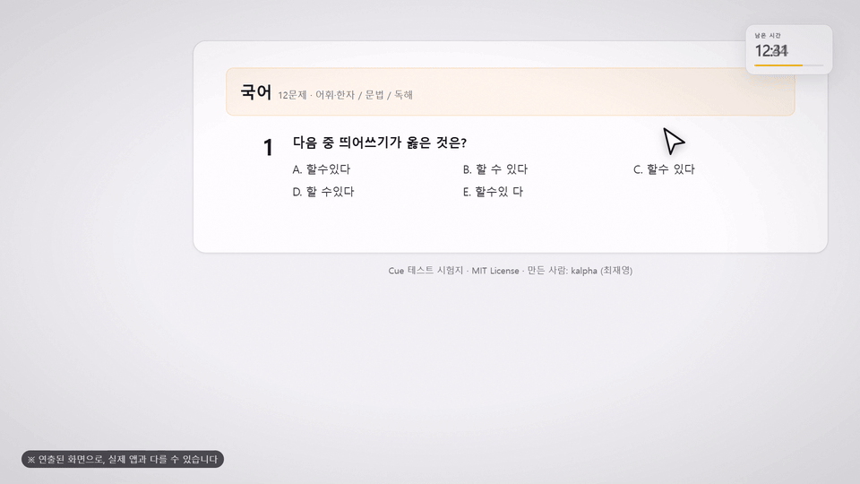

# Cue

포인터 아래의 문제를 읽어 비전 지원 AI에 묻고, 정답을 최대한 티 나지 않게 보여 주는 Windows 시험 도우미입니다. 자신의 API 키를 사용하며 계정·구독·텔레메트리가 없습니다.

**만든 사람: kalpha (최재영)** · GitHub [@gguatit](https://github.com/gguatit)

> [!WARNING]
> **시험 규정 위반과 제재 — 반드시 읽으세요**
>
> Cue는 **시험·자격 시험·온라인 평가·과제에서 사용이 금지되는 것이 일반적**입니다. 사용하면 **시험 무효, 성적 취소, 자격 박탈, 정학·퇴학·징계, 응시 자격 제한** 같은 규정상 제재를 받을 수 있고, 기관·주최 측 약관에 따라 **민사·형사 책임**이 발생할 수 있습니다. 감시 프로그램이 프로세스·서비스·창 목록·웹캠을 통해 사용을 확인할 수 있으며, Cue는 "탐지 불가"를 보장하지 않습니다. **사용과 그 결과에 대한 책임은 전적으로 사용자에게 있습니다.**

## 시연 영상



18초짜리 사용 흐름입니다. 전체 영상은 [docs/promo/cue-promo.mp4](docs/promo/cue-promo.mp4)에서 볼 수 있습니다. ※ 영상 속 답 패널은 연출된 화면으로, 실제 앱과 다를 수 있습니다.

## 시험 규정 및 제재 (중요)

- **허용되는 시험인지 먼저 확인하세요.** 주최 기관의 응시 규정, 학사 규정, 자격 시험 약관에 "보조 도구·AI·화면 캡처·외부 프로그램 금지" 조항이 있으면 Cue 사용은 위반입니다.
- **제재 예시**: 시험 무효·퇴장, 성적·합격 취소, 자격 정지·박탈, 학사 징계(경고·정학·퇴학), 향후 응시 제한, 이미 취득한 자격·학위의 사후 취소.
- **감지 가능성**: 화면 공유·감시 프로그램·시험 감독관·웹캠이 트레이 아이콘, 작업표시줄, 프로세스/서비스 목록, LED·밝기 깜빡임, 실행 흔적을 확인할 수 있습니다. Cue의 스텔스 기능은 **탐지 불가를 보장하지 않습니다.**
- **책임**: Cue를 내려받아 사용함으로써 발생하는 규정 위반·제재·법적 분쟁은 사용자 본인의 책임입니다. 제작·배포자는 사용자가 규정을 준수할 책임을 대신하지 않습니다.
- **업무·시험 환경 배포 금지**: 규정을 위반할 목적으로 조직 내에 배포하거나 판매하지 마세요.

## 기능

- **단축키 하나**: `Ctrl+Alt+Win`(변경 가능)을 누른 채 선택한 마우스 버튼을 클릭하면 포인터가 있는 디스플레이를 캡처해 설정한 AI에 묻습니다. 기본값은 왼쪽 클릭이며, 키만 누르면 발동하지 않습니다.
- **다섯 가지 답 표시**(각각 켜고 끌 수 있음):
  - 시스템 아이콘처럼 위장한 트레이 아이콘
  - 커서 옆 오버레이
  - 전체 화면 플래시
  - Caps/Num/Scroll 키보드 LED 깜빡임(1회 = A … 5회 = E)
  - 화면 밝기 깜빡임(DDC/CI, 실패 시 감마 폴백)
- **다중 정답**: 오버레이와 플래시는 모든 정답을 보여 줍니다(예: `A, C`). 트레이·LED·밝기는 첫 번째 정답만 사용합니다.
- **서술형 답변**: 워터마크 문자 정리와 선택적 패러프레이즈를 거친 텍스트 패널을 오버레이로 표시합니다.
- **자유 모드**: 답변 단축키를 누른 채 다른 마우스 버튼을 클릭하면 커서 주변의 코드·텍스트·도표를 설명합니다. 지시문을 직접 바꿀 수 있습니다.
- **교차 검증**: 같은 공급자의 두 번째 모델로 객관식 답을 검증합니다. 일치 여부를 표시하고, 불일치하면 두 답을 함께 보여 줍니다.
- **답변 히스토리**와 영구 오류 로그, 패닉 클리어(`Ctrl+Alt+Shift+X`, 변경 가능).
- **스텔스**: 작업표시줄에서 숨기기, Cue 창을 화면 캡처에서 제외, 로그인 시 무음 시작, 위장 트레이 아이콘.
- **회의 안전 모드**: Zoom/Teams/Webex/Meet 계열 프로세스나 창 제목이 감지되면 화면 기반 표시를 숨기고 LED·밝기만 사용합니다.
- **생존 보호**: 선택적 사용자 예약 작업이 Cue가 강제 종료되면 다시 실행합니다(최선의 노력, 관리자 강제 종료·그룹 정책에는 밀릴 수 있음).
- **최대 보호**: 관리자 권한으로 실행해 일반 작업 관리자의 종료를 거부하고, 최고 권한 로그온 작업과 **CueWatchdog SYSTEM 서비스**를 등록합니다. 서비스는 Cue가 강제 종료되면 다시 실행하고, 관리자가 서비스를 종료해도 Windows가 약 5초 안에 다시 시작합니다. UAC는 한 번만 요청합니다. 관리자의 서비스 중지·삭제, 그룹 정책, Windows 종료는 막을 수 없습니다.
- **내 키 사용**: OpenCode Go(구독), OpenCode Zen(크레딧), OpenAI, Google, Anthropic 또는 사용자 지정 OpenAI 호환 base URL별 키. Go는 전용 모델 목록을 사용합니다. OpenCode Zen 모델은 계열별 네이티브 API(Anthropic Messages / Google generateContent / Responses)로 자동 라우팅됩니다. 키는 Windows 자격증명 관리자에 저장되며 웹 UI에 노출되지 않습니다.
- **모델 도우미**: 공급자 모델 목록 불러오기, 비전 검사를 포함한 연결 테스트, 5초 카운트다운 실전 테스트, 일시적 AI 오류 재시도, 포인터 주변 자르기 옵션.
- **설정 도구**: 서술형 답변 언어·상세 수준, 표시 시간, JSON 백업/가져오기, 로컬 프로필, GitHub에서 내려받는 워터마크 토글 포함 시험지.
- **자동 업데이트**: GitHub Releases의 서명된 새 버전을 확인합니다. 설정 → 정보에서 자동 확인을 끌 수 있고, 설치는 사용자가 확인한 뒤 진행합니다. perMachine 설치라 UAC가 한 번 필요합니다.
- 한국어/영어 UI.

> [!WARNING]
> **전역 단축키 충돌 가능성**: 단축키는 다른 앱이나 Windows 단축키와 충돌할 수 있습니다. 보조키만 쓰는 조합은 다른 프로그램이 먼저 가로챌 수 있고, 답변 단축키와 패닉 단축키가 같은 보조키를 공유하면 한쪽이 동작하지 않을 수 있습니다. 답변은 기본적으로 보조키를 누른 채 선택한 마우스 버튼을 클릭해야 발동합니다. 시험 환경에서 먼저 테스트하고, 필요하면 설정에서 다른 조합이나 마우스 버튼을 고르세요. 대상 앱이 관리자 권한으로 실행 중이면 Cue도 관리자 모드로 실행해야 할 수 있습니다.

## 설정

1. Cue를 설치하고 실행합니다. 트레이 아이콘이 보이도록 유지하세요(온보딩이 안내합니다).
2. 설정 → AI: 공급자 프리셋을 고르고, 모델을 불러와 비전 지원 모델을 선택한 뒤 API 키를 붙여넣고 연결을 테스트합니다.
3. 설정 → 모드: 답 표시를 최소 하나 켜고, 필요하면 트레이 위장 아이콘을 조정합니다.
4. 문제 위에 포인터를 두고, 단축키를 누른 채 설정한 마우스 버튼을 클릭합니다.

자유 모드는 설정 → 일반에서 켭니다. 프롬프트를 직접 쓰기 어렵다면 아래 문장을 자유 모드 지시문에 그대로 붙여 넣으세요.

### 자유 모드 추천 지시문

```text
상황에 맞게 판단하여 질문에 직접 답하거나 설명하세요.

- 핵심부터 명확하게 답하고, 불필요한 서론·반복·메타 설명은 생략하세요.
- 질문의 의도와 맥락에 맞춰 답변의 길이와 형식을 조절하세요.
- 답변 내용에 집중하고, 답변을 작성하는 과정이나 답변 자체를 설명하지 마세요.
- '커서는'이라는 표현과 '뭐뭐 하고 있습니다', '뭐뭐 한다는 설명입니다' 및 이와 유사한 불필요한 표현을 사용하지 마세요.
- 별도의 설명이 필요하지 않다면 답만 제시하세요.
```

## 참고

- Windows 10/11 x64 전용입니다.
- 설치 파일은 WebView2 오프라인 런타임을 포함하므로 크지만 인터넷 없이 설치할 수 있습니다.
- 설치 파일은 Authenticode 서명이 없어 Windows SmartScreen 경고가 나올 수 있습니다. 업데이트 서명은 설치 파일의 무결성만 검증하며 SmartScreen 경고를 없애지는 않습니다.
- 0.1.2부터 설정 → 정보에서 GitHub Releases의 서명된 새 버전을 확인하고 설치할 수 있습니다. 업데이트는 perMachine 설치라 UAC가 한 번 필요하고, WebView2 오프라인 런타임을 포함한 설치 파일(약 221MB)을 내려받습니다.
- 0.1.0/0.1.1 사용자는 0.1.2를 한 번 직접 설치해야 이후 자동 업데이트가 동작합니다.
- 서술형 답변은 오버레이 전용이며 클릭 통과라 매우 긴 글은 잘릴 수 있습니다.
- 회의 감지는 휴리스틱이므로 회의 앱이 실행만 되어 있어도 동작할 수 있습니다.
- 개발 문서: `AGENTS.md`(에이전트 규칙), `docs/CHANGELOG.md`(변경 기록), `scripts/latest-json.ps1`(업데이트 매니페스트).

## 빌드

Node.js와 Rust가 필요합니다.

```
npm ci
npm run icon
npm run tauri build
```

NSIS 설치 파일은 `src-tauri/target/release/bundle/nsis/`에 생성됩니다.

업데이트용 `.sig`까지 만들려면 서명 키를 환경 변수로 지정해야 합니다. `latest.json`은 `scripts/latest-json.ps1`로 UTF-8 BOM 없이 생성해 업로드합니다. 개인 키와 비밀번호는 저장소에 커밋하지 마세요.

```
$env:TAURI_SIGNING_PRIVATE_KEY = "$env:USERPROFILE\.tauri\cue\cue.key"
$env:TAURI_SIGNING_PRIVATE_KEY_PASSWORD = "<password>"
npm run tauri build
```

## 테스트

```
npm run check && npm test
cargo test --manifest-path src-tauri/Cargo.toml
```

## English summary

**Warning:** Cue is commonly prohibited in exams, licensing tests, and graded assessments. Using it can result in the exam being voided, grades or qualifications being revoked, academic discipline (including suspension or expulsion), or loss of future eligibility, and may create civil or criminal liability under the institution's terms. Proctoring tools can detect the process, service, tray icon, or webcam activity; Cue does not guarantee undetectability. You are solely responsible for your use of Cue.

Cue is a Windows exam helper. Press a global hotkey while pointing at a question; Cue captures the display under the pointer, asks your own OpenAI-compatible vision model, and shows the answer through a disguised tray icon, a cursor overlay, a full-screen flash, keyboard LED blinks, or screen-brightness blinks. It includes descriptive answers, answer history, panic clear, meeting safe mode, a survival guard, and a SYSTEM watchdog service (CueWatchdog) for maximum protection. Keys live in Windows Credential Manager; there is no account, subscription, or telemetry. Automatic updates check signed GitHub Releases. Windows 10/11 x64 only. MIT licensed. Created by kalpha (Choi Jaeyoung).

## License

MIT
