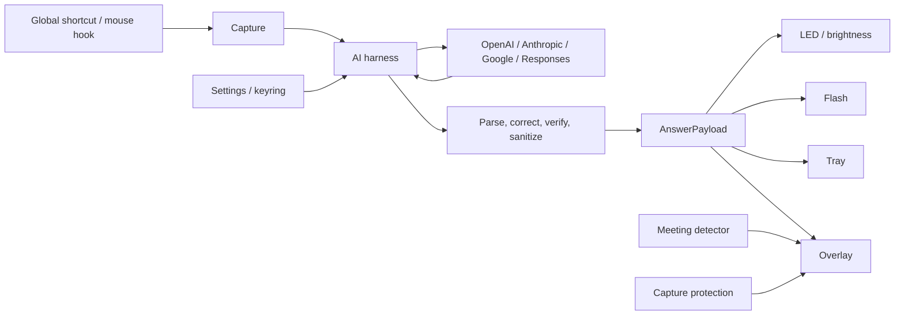

# Cue 아키텍처

이 문서는 Cue가 **어떻게 동작하는지**를 코드 기준으로 정리한 내부 문서입니다. 사용법은 [README](../README.md), AI 요청·프롬프트 계약은 [AI_HARNESS.md](AI_HARNESS.md), 제품 결정은 [IDEAS.md](IDEAS.md)를 참고하세요.

- 현재 버전: **1.0.0**
- 플랫폼: Windows 10/11 x64
- 스택: Tauri 2, React 19, Vite, Tailwind CSS 4, Rust

## 1. 설계 목표

| 목표 | 의미 |
|---|---|
| 한 번의 동작 | 단축키 + 마우스 클릭으로 캡처·AI 요청·표시를 끝낸다. |
| 포인터 기준 | 화면 전체가 아니라 커서가 있는 모니터와 문제 주변을 사용한다. |
| 공급자 독립 | OpenAI·Anthropic·Google·Responses API를 같은 계약으로 다룬다. |
| 출력 독립 | 같은 답을 오버레이·트레이·플래시·LED·밝기로 보낼 수 있다. |
| 로컬 우선 | 서버·계정·텔레메트리 없이 PC에서 완결된다. |
| 실패 시 안전 | 캡처 보호가 실패하면 답을 표시하지 않는다. |
| 조용한 실패 | 오류는 코드로 반환하고 UI에서 짧게 안내한다. |

### 비목표

- 범용 채팅 클라이언트
- 다중 문제 일괄 풀이
- OCR 기반 텍스트 추출
- 서버 기반 계정·동기화·분석
- macOS/Linux 지원
- 탐지 불가 보장

## 2. 전체 흐름



## 3. 프로세스와 창 모델

Cue는 **main**과 **overlay** 두 개의 Tauri 웹뷰를 사용합니다.

- 두 웹뷰는 같은 `index.html`을 사용하고, `App.tsx`가 웹뷰 label로 분기합니다. `?view=` 쿼리는 사용하지 않습니다.
- 창은 `tauri.conf.json`이 아니라 `src-tauri/src/windows.rs`에서 코드로 만듭니다. 설정의 `"windows": []`는 정상입니다.
- 오버레이는 시작 시 만들지 않고, 첫 `show_overlay`/`capture_and_answer(prepare_overlay)` 때 생성합니다.
- 오버레이가 필요한 설정(오버레이·플래시·텍스트·자유 모드)에서는 답변 단축키 보조키가 눌린 순간 prewarm합니다.
- 오버레이 첫 표시는 `OverlayView`의 `overlay_ready` 호출 뒤에 이루어져 첫 payload 유실을 막습니다.
- `capture_protection_status.overlay`는 오버레이 생성 전까지 `null`입니다.

### 프론트엔드 경계

- `src/App.tsx`: main/overlay label 분기, 온보딩/설정 전환.
- `src/views/settings/*`: 설정 탭. `SettingsHome`이 사이드바와 lazy 탭을 담당합니다.
- `src/overlay/*`: 오버레이 UI와 스트리밍 페이싱.
- `src/lib/tauri.ts`: **유일한 invoke 래퍼**. 컴포넌트가 직접 invoke하지 않습니다.
- `src/stores/settings.ts`: zustand persist 설정.
- `src/stores/answer.ts`: 마지막 요청·기록·오류 로그.
- `src/stores/updates.ts`: 업데이트 UI 상태.

## 4. 캡처 파이프라인

`src-tauri/src/capture.rs`가 담당합니다.

```text
global shortcut / mouse hook
  → cursor monitor 선택
  → GDI BitBlt
  → GetDIBits (DC에서 비트맵 선택 해제 후)
  → 장변 1920 이하로 축소
  → 커서 좌표를 같은 비율로 변환
  → 필요 시 1600×1000 크롭
  → JPEG base64
```

### 규칙

- 커서가 있는 모니터만 캡처합니다.
- 장변 1920 이하로 축소합니다.
- 크롭은 1600×1000을 사용합니다.
- 픽셀 상한은 40M(`capture::capture_fits`)입니다.
- `capture_in_flight`로 중복 실행을 막습니다.
- GDI 비트맵은 `GetDIBits` 전에 DC에서 선택 해제합니다.
- 리사이즈는 CatmullRom을 사용합니다.

### 좌표와 DPI

- 캡처 이미지의 커서 좌표는 축소 비율에 맞춰 변환합니다.
- 오버레이 배지·텍스트 크기는 창의 `scale_factor`가 아니라 **대상 모니터의 DPI**(`windows::monitor_scale`)로 계산합니다.
- 오버레이 위치는 작업 영역(`work area`)과 창 크기를 기준으로 계산하며, 음수 좌표와 다중 모니터를 고려합니다.

## 5. AI 하네스

`src-tauri/src/ai.rs`와 `src-tauri/src/commands.rs`가 담당합니다. 상세 내용은 [AI_HARNESS.md](AI_HARNESS.md)에 있습니다.

### 계층

| 계층 | 역할 |
|---|---|
| 공급자 추상화 | `Provider`, `Api`, `api_for`, `endpoint`, `api_headers` |
| 요청 생성 | `build_body`, `build_stream_body`, `correction_body` |
| 프롬프트 | `SCREENSHOT_RULES`, `build_prompt`, `build_text_prompt`, `build_free_prompt`, `paraphrase_prompt` |
| 전송 | `post_api` — 429/5xx 재시도, `Retry-After`, 전체 요청 예산 |
| 파싱 | `parse_answers`, JSON/텍스트 추출 |
| 교정 | 잘못된 JSON에 대해 **한 번만** correction 요청 |
| 교차 검증 | `merge_consensus` — 1차/2차 답 비교 |
| 대체 | `answers_with_fallback`, `text_with_fallback`, `free_with_fallback` |
| 사용량 | `extract_usage`, `merge_usage`, `flatten_usage` |
| 스트리밍 | SSE 파싱, 누적 텍스트 콜백, 80ms throttle |
| 정리 | `sanitize_text` — 보이지 않는 문자·HTML 태그 제거 |

### 요청 모드

- **객관식**: JSON `{"answers":["X"]}`. 최대 4개, 확신 순.
- **서술형**: 플레인 텍스트. 언어·상세 수준 규칙 적용.
- **자유 모드**: 커서 주변 설명·요약·번역. 사용자 지시 적용.
- **패러프레이즈**: 결과 텍스트를 한 번만 재작성.
- **교차 검증**: 객관식에서만, 같은 공급자의 두 번째 모델 사용.
- **스트리밍**: 서술형·자유 모드에서만. 객관식은 비스트림.

### 실패 처리

```text
요청 실패
  → 재시도 가능한가? (429/5xx/timeout)
    → 예: Retry-After 대기 후 재시도
    → 아니오: 오류 코드 반환
  → JSON 형식 오류
    → correction_body로 1회 교정
    → 다시 실패: parse 오류
  → 대체 모델 설정?
    → fallback_allowed 오류면 대체 모델로 1회
  → 서술형 스트리밍 실패
    → 같은 요청 안에서 비스트림 1회
    → 둘 다 실패: 오버레이 숨김
```

## 6. 출력 파이프라인

`commands.rs`가 `AnswerPayload`를 만들고, 설정에 따라 출력합니다.

```text
AnswerPayload
  ├─ Choice { answers, verification, usage, highlight }
  ├─ Text { text, usage, streamed }
  └─ None { reason }
```

### 출력 방식

| 방식 | 모듈 | 다중 정답 | 특징 |
|---|---|---|---|
| 오버레이 | `windows.rs`, `OverlayView` | 모두 | 클릭 통과, DPI 보정, 캡처 보호 |
| 트레이 | `tray.rs` | 첫 번째 | 위장 아이콘, 툴팁/메뉴 |
| 플래시 | `windows.rs` | 모두 | 짧은 전체 화면 |
| LED | `led.rs` | 첫 번째 | Caps/Num/Scroll |
| 밝기 | `brightness.rs` | 첫 번째 | DDC/CI, 감마 폴백 |

### 오버레이

- 스타일: `answer` / `text`.
- 텍스트는 설정된 위치(중앙, 네 모서리, 카메라 아래, 커서 옆)에 표시합니다.
- 서술형 스트리밍은 `streamPacing.ts`가 `requestAnimationFrame`으로 글자 표시 속도를 조절합니다.
- 텍스트 오버레이 크기는 글자 수·줄 수로 계산하고, 스트리밍 중 80ms마다 다시 계산합니다. 일반 텍스트는 최대 70%, 커서 밀착은 50% 높이까지 커집니다.
- 스트림 종료 시 `stream_done(id, duration_ms)`가 표시 시간 타이머를 시작합니다.
- `OVERLAY_GEN`으로 오래된 hide 타이머가 새 답변을 지우지 않게 합니다.
- `overlay_ready` 전에는 첫 payload를 표시하지 않습니다.
- 실험실의 하이라이트는 모델이 반환한 정답 선택지 위에 박스만 그립니다. 화면 전체 딤과 정답·검증 텍스트는 표시하지 않으며, 전체 화면 오버레이에서도 fail-closed와 클릭 통과를 유지합니다.

### Cue Air (실험실)

- 실험실에서 `휴대폰에 답변 표시`를 켜면 PC가 로컬 HTTP 서버를 연다.
- 같은 Wi-Fi의 휴대폰이 QR의 URL과 일회성 토큰으로 접속한다.
- 서버는 최신 답변 하나만 보관하고, 답변이 갱신될 때마다 휴대폰이 폴링한다.
- 실험실의 `서버 재생성`은 기존 서버를 닫고 새 토큰·포트로 다시 열어 기존 QR을 무효화한다.
- 최종 답변 publish는 한 경로로 모으고, 스트리밍 답변은 250ms 간격으로만 휴대폰에 전달한다. 휴대폰 페이지는 화면이 꺼져 있으면 폴링을 멈춘다.
- 기능을 끄거나 앱을 종료하면 서버와 세션을 즉시 닫는다. 계정·클라우드·답변 기록은 없다.
- 로컬 HTTP는 암호화되지 않으므로 같은 네트워크에서 토큰을 아는 사람은 답변을 볼 수 있다. 기본 OFF와 경고를 유지한다.

### 회의 안전 모드

`meeting.rs`가 프로세스·창 제목 신호를 수집하고, 설정(`stealth.meetingPolicy`)에 따라 회의 여부를 판단합니다.

- 프로세스 + 창 제목
- 창 제목만
- 프로세스만

감지 시 오버레이·플래시 같은 화면 기반 출력은 숨기고 LED·밝기만 사용합니다. 휴리스틱이므로 회의 앱이 실행만 되어 있어도 동작할 수 있습니다.

## 7. 스텔스와 캡처 보호

### 창 수준

- 작업표시줄에서 숨김
- 위장 트레이 아이콘
- 로그인 시 무음 시작
- 포커스 손실 시 숨김(설정)
- `WDA_EXCLUDEFROMCAPTURE` 캡처 제외

### 캡처 보호

`windows.rs`가 `SetWindowDisplayAffinity`를 적용합니다.

- **소프트웨어 캡처**: Windows 화면 캡처 API, 화면 녹화, Zoom/Teams/Webex/Meet 화면 공유에서 제외됩니다.
- **하드웨어 캡처**: HDMI 캡처 카드·외부 녹화기처럼 물리 출력을 직접 받는 장치는 예외입니다.
- **fail-closed**: `show_overlay`가 WDA 적용 실패 또는 affinity != `0x11`을 확인하면 답변을 표시하지 않고 숨깁니다.

> 캡처 보호는 "탐지 불가" 보장이 아닙니다. 프로세스·서비스·트레이·LED·밝기·실행 흔적은 별도로 관찰될 수 있습니다.

## 8. 입력 훅과 트리거

`src-tauri/src/shortcut.rs`가 담당합니다. Tauri 플러그인이 아니라 저수준 Windows 훅을 직접 사용합니다.

- 답변 단축키: 보조키 + 마우스 버튼 클릭.
- 패닉 단축키: 기본 `Ctrl+Alt+Shift+X`.
- 마우스 전용: hold / shake.
- 실험실 자동 답변: 포인터가 700ms 정지하면 `trigger-answer`를 발행하고, 발동 후에는 포인터 이동 전까지 반복하지 않음.
- 실험실 미리 캡처: 400ms 정지 시 원본 화면만 `AppState.pre_capture`에 저장하고, 2.5초·24px 이내 캐시만 답변 캡처에 재사용.
- 테스트 모드: `gesture-test` 이벤트만 발행하고 캡처·AI를 실행하지 않음.
- 입력 훅과 트레이는 메인 스레드에서 60초마다 재등록·복구합니다.
- 명령 스레드에서 `SetWindowsHookEx`를 호출하지 않습니다.

### 알려진 충돌

- 다른 앱·Windows 단축키와 충돌할 수 있습니다.
- 답변 단축키가 modifier-only이고 패닉과 mods가 겹치면 패닉이 가려질 수 있습니다.
- 클릭 모드에서는 키보드 답변 발동을 끕니다.
- 대상 앱이 관리자 권한이면 Cue도 관리자 모드로 실행해야 할 수 있습니다.

## 9. 보호와 관리자 모드

`guard.rs`, `elevation.rs`, `main.rs`가 담당합니다.

### 사용자 보호

- HKCU Run 키
- 예약 작업: `Cue Elevated`, `Cue Guard`, `Cue Guard Boot`
- 선택적 워치독: `CueWatchdog` 서비스
- `C:\ProgramData\Cue` 상태와 ACL

### 관리자 모드

- 서비스 설정은 HKLM `Software\Cue`의 `App`, `User`에 저장합니다.
- `C:\ProgramData\Cue` ACL은 SYSTEM/Administrators Full + Users RX로 강제합니다.
- 관리자 모드가 실행할 exe는 Program Files 또는 `--admin-prepare`가 만든 `C:\ProgramData\Cue\cue.exe` 보호 복사본이어야 합니다.
- 설치 폴더가 사용자 쓰기 가능해도 관리자 모드는 그 경로를 실행하지 않습니다.
- HKLM `User`가 없으면 `/RU` 없는 작업을 만들지 않습니다.
- 프로그램 마커가 있으면 비관리자 실행도 보호 복사본으로 자동 재실행됩니다.

### 한계

- 관리자의 서비스 중지·삭제, 그룹 정책, Windows 종료는 막을 수 없습니다.
- 워치독·예약 작업은 최선의 노력입니다.
- 설치·제거는 사용자가 직접 합니다.

## 10. 설정과 상태

`src/stores/settings.ts`는 zustand persist를 사용합니다.

- 저장 키: `cue-settings`
- 현재 버전: **28**
- `defaults` + `mergeSettings` + `version`을 함께 올려 마이그레이션합니다.

주요 설정:

- `free`
- `mouse`: hold/shake, ms/px
- `provider`: preset, model, baseUrl, consensus, verifyModel, fallbackModel, streaming
- `answer`: language, level, displayTime, showUsage
- `display`: textPosition, output methods
- `experimental`: enabled, predictive, highlight, cueAir, showWarnings
- `stealth`: meetingPolicy, hideOnBlur
- `appearance`: theme, accent
- `shortcut`, `panic`, `onboarded`

기타 저장소:

- `cue-history`, `cue-errors`
- `cue-profiles` (`src/lib/settingsBackup.ts`)
- `cue-update-check`
- `src/stores/updates.ts`

### 키 보관

- API 키는 Windows 자격증명 관리자(`secrets.rs`)에만 저장합니다.
- 설정 내보내기와 프로필에는 키가 포함되지 않습니다.
- 로그에 키를 남기지 않습니다.

## 11. 업데이트와 릴리스

`src-tauri/src/updates.rs`와 `commands.rs`가 담당합니다.

```text
설정 → 정보
  → GitHub Releases latest.json 확인
  → 서명 검증
  → 사용자 확인
  → 다운로드
  → NSIS /P /UPDATE /R
  → 앱 종료 후 설치
```

- 엔드포인트: `https://github.com/gguatit/cue/releases/latest/download/latest.json`
- `latest.json`은 UTF-8 BOM 없이 생성합니다.
- `Cache-Control`/`Pragma: no-cache`로 프록시 캐시를 피합니다.
- draft/prerelease는 `/releases/latest`에 노출되지 않습니다.
- 서명 키는 `%USERPROFILE%\.tauri\cue\`에만 보관합니다.
- 키 분실·교체는 기존 사용자의 수동 설치를 의미합니다.
- 업데이트는 uninstaller 훅을 호출하지 않아 제거 정리를 보존합니다.

### NSIS

- perMachine
- WebView2 offline installer
- `src-tauri/windows/hooks.nsh`
- `/UPDATE`에서는 `PREINSTALL`/`POSTINSTALL`만 실행됩니다.
- `POSTINSTALL`의 `--admin-prepare` 실패는 `admin-prepare.failed` 마커로 남깁니다.

## 12. 코드 맵

| 경로 | 역할 |
|---|---|
| `src-tauri/src/main.rs` | CLI 모드, single-instance, setup, invoke 등록 |
| `src-tauri/src/commands.rs` | invoke 커맨드, AppState, HTTP 클라이언트, 캡처·AI·출력 오케스트레이션 |
| `src-tauri/src/ai.rs` | 프롬프트, 공급자 라우팅, HTTP, 파싱, 재시도, 스트리밍, 사용량 |
| `src-tauri/src/capture.rs` | GDI 캡처, 커서 모니터, 축소, 크롭 |
| `src-tauri/src/shortcut.rs` | 저수준 키보드·마우스 훅, 제스처 |
| `src-tauri/src/windows.rs` | main/overlay 창, DPI, 스텔스, 캡처 보호 |
| `src-tauri/src/tray.rs` | 트레이 아이콘, 메뉴, 위장 |
| `src-tauri/src/meeting.rs` | 회의 프로세스·창 감지 |
| `src-tauri/src/led.rs` | 키보드 LED |
| `src-tauri/src/brightness.rs` | DDC/CI·감마 밝기 |
| `src-tauri/src/guard.rs` | 예약 작업·워치독·상태 |
| `src-tauri/src/elevation.rs` | UAC, 관리자 복사본, ProgramData |
| `src-tauri/src/updates.rs` | 업데이트 확인·다운로드·서명 설치 |
| `src-tauri/src/models.rs` | 모델 목록 |
| `src-tauri/src/secrets.rs` | 자격증명 관리자 |
| `src-tauri/src/air.rs` | Cue Air 로컬 서버·QR·최신 답변 |
| `src/App.tsx` | main/overlay 분기 |
| `src/lib/tauri.ts` | invoke 래퍼 |
| `src/views/settings/*` | 설정 UI |
| `src/views/settings/ExperimentalTab.tsx` | 실험실 경고·플래그·하이라이트 미리보기 |
| `src/overlay/*` | 오버레이·스트리밍 페이싱 |
| `src/stores/*` | 설정·답변·업데이트 상태 |

## 13. 실패 모드와 불변식

- **캡처 보호 실패**: 답을 표시하지 않음(fail-closed).
- **오버레이 준비 전 payload**: `overlay_ready` 전에는 표시하지 않음.
- **오래된 hide 타이머**: `OVERLAY_GEN`으로 새 답변을 지우지 못하게 함.
- **중복 캡처**: `capture_in_flight`로 차단.
- **키 없는 요청**: `custom` + 루프백 URL에만 허용.
- **공식 프리셋**: 공식 엔드포인트 고정, 사용자 입력으로 덮어쓰지 않음.
- **리다이렉트**: HTTP 클라이언트가 추적하지 않음.
- **업데이트 서명**: 검증을 끄거나 느슨하게 하지 않음.
- **설정 마이그레이션**: 기존 사용자 설정을 깨지 않음.
- **실험 기능**: 기본 OFF, 실험실 경고·마스터 스위치 유지. 정식 탭으로 옮기기 전까지 실험실에 둔다. 미리 캡처·하이라이트는 입력 훅/좌표 지원에 따라 동작이 달라질 수 있다. 커서 밀착 답변은 0.6.0에서 표시 탭의 정식 위치로 이동했다.
- **오류 코드**: 새 코드는 `src/i18n.ts::ERRORS`에 en/ko 쌍으로 추가.

## 14. 테스트 전략

- TypeScript: `npm run check`, `npm test` (Vitest, node 환경, jsdom 없음).
- Rust: `cargo test --manifest-path src-tauri/Cargo.toml`.
- UI: Vite dev 또는 빌드된 `dist`를 실제 렌더링해 확인.
- Rust 테스트는 Windows API 없이 계산 가능한 순수 함수(좌표·크기·파서·URL 검증) 위주.
- 컴포넌트 테스트는 `renderToStaticMarkup`으로 HTML 문자열을 검증합니다.
- 실제 앱 동작은 `npm run tauri dev` 또는 설치된 앱에서 확인합니다.

## 15. 관련 문서

- [README](../README.md)
- [AI_HARNESS.md](AI_HARNESS.md)
- [IDEAS.md](IDEAS.md)
- [OUT_OF_SCOPE.md](OUT_OF_SCOPE.md)
- [AI_PARAMETER_PRESETS.md](AI_PARAMETER_PRESETS.md)
- [CHANGELOG.md](CHANGELOG.md)
- [AGENTS.md](../AGENTS.md)
